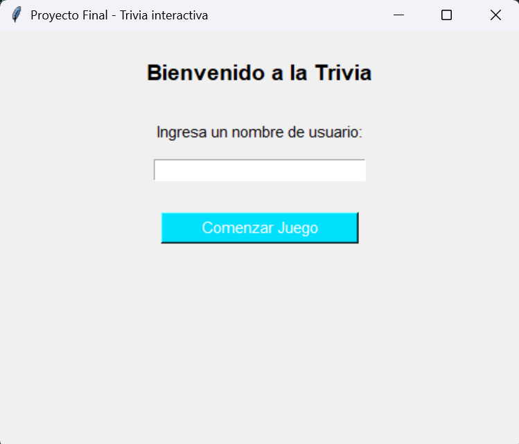
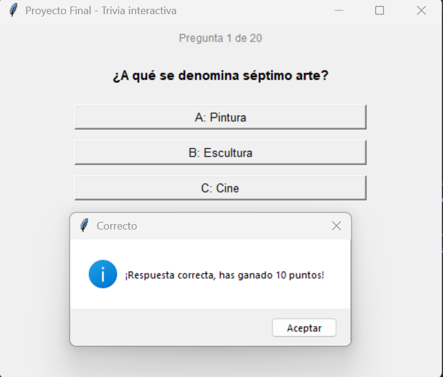
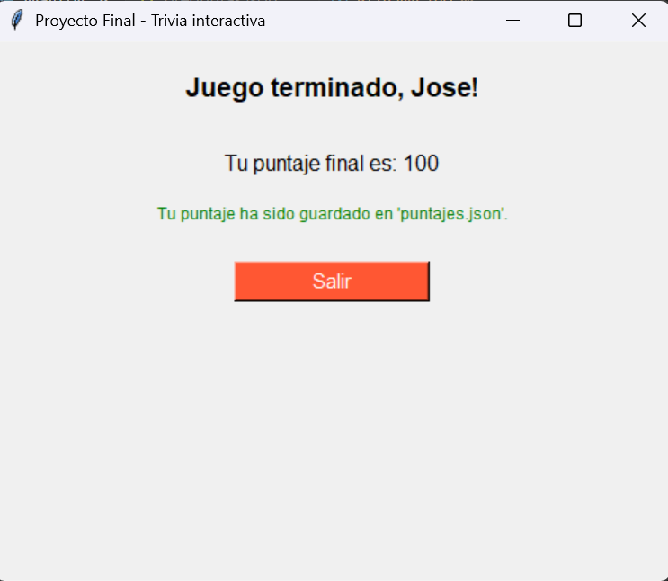

                                                            PROYECTO FINAL-JUEGO INTERACTIVO (TRIVIA)
Proyecto final de programación desarrollado en Python utilizando Programación Orientada a Objetos (POO), interfaz gráfica con Tkinter y persistencia de datos mediante  
archivos JSON.

                                                                    Descripción del Proyecto
Aplicación de escritorio interactiva que carga un banco de preguntas desde un archivo externo (`preguntas.json`), evalúa al usuario en tiempo real con opción múltiple, emite alertas visuales/sonoras y registra automáticamente los puntajes finales en un archivo de resultados (`puntajes.json`).

                                                                      Requisitos del Sistema
- **Python 3.12.0** o superior (utiliza librerías nativas: `tkinter`, `json`, `os`, `winsound`).
- Sistema operativo: Windows (para soporte nativo de efectos de sonido con `winsound`).

                                                                    Instrucciones de Ejecución
1. Clona este repositorio o descarga los archivos en tu computadora.
2. Asegúrate de tener los archivos `Main.py` y `preguntas.json` dentro de la misma carpeta.
3. Abre una terminal en la ruta del proyecto y ejecuta el siguiente comando:
   ```bash
   python Main.py




   